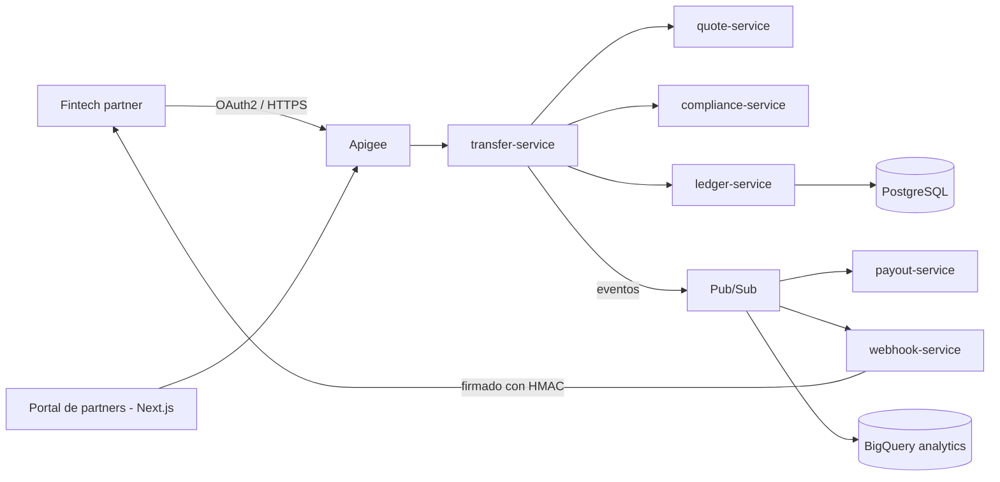

# Puente

**Plataforma API-first de remesas y pagos transfronterizos en Google Cloud.**

Puente permite a fintechs y empresas de remesas enviar dinero de EE. UU. a Centroamérica (SV, GT, HN) mediante una sola API: cotizaciones de tipo de cambio en tiempo real, verificación contra listas de sanciones, un ledger de partida doble, pagos a bancos y billeteras, y webhooks firmados. Está diseñada para nunca perder ni duplicar un centavo.

> 🚧 **Estado:** Fase 0 — fundamentos y walking skeleton. Este README describe la plataforma objetivo; la [hoja de ruta](#hoja-de-ruta) muestra lo que ya está construido.

---

## Por qué este proyecto

Las remesas son una parte central de las economías centroamericanas, pero integrarse con redes de pago es lento, frágil y difícil de auditar. Puente es una implementación de referencia de cómo una plataforma de pagos moderna y cloud-native debe **diseñarse, asegurarse, operarse y recuperarse**, no solo programarse.

## Capacidades principales

| Capacidad | Cómo |
|---|---|
| **Movimiento de dinero exactly-once** | `Idempotency-Key` en cada escritura; los reintentos nunca duplican una transferencia |
| **Ledger de partida doble** | Asientos de débito/crédito inmutables y balanceados; objetivo de RPO 0 |
| **Verificación de cumplimiento** | Listas de sanciones (OFAC SDN), límites por cliente, reglas de velocidad, cola de revisión manual |
| **Pagos resilientes** | Adaptadores a bancos y billeteras simulados que fallan a propósito; circuit breakers, reintentos, DLQ |
| **Webhooks para partners** | Firmados con HMAC, entrega at-least-once con backoff exponencial |
| **Gestión de APIs** | Apigee: OAuth2 client credentials, API products, cuotas, spike arrest, versionado |
| **Portal de partners** | Portal y back-office de cumplimiento en Next.js + TypeScript con autenticación OIDC |

## Arquitectura objetivo



## Servicios

| Servicio | Responsabilidad | Patrón clave |
|---|---|---|
| `quote-service` | Cotizaciones de tipo de cambio con TTL | Caché, expiración |
| `transfer-service` | Ciclo de vida de la transferencia | Saga orquestada, máquina de estados |
| `compliance-service` | Sanciones, límites, velocidad | Motor de reglas, registro de auditoría |
| `ledger-service` | Contabilidad de partida doble | Consistencia fuerte, transactional outbox |
| `payout-service` | Adaptadores de bancos y billeteras | Idempotencia, circuit breaker |
| `webhook-service` | Notificaciones a partners | At-least-once, DLQ, backoff |
| `partner-portal` | Portal y back-office | OIDC, entrega por CDN |

## Hoja de ruta

| Versión | Alcance | Plataforma | Estado |
|---|---|---|---|
| **v0** | Walking skeleton: servicios de quote y transfer, IaC, CI/CD sin llaves, controles de costo | Cloud Run | 🟡 En progreso |
| **v1** | Todos los servicios, Apigee, Identity Platform, portal de partners | Cloud Run | ⚪ Planeado |
| **v2** | Red privada, PostgreSQL administrado, Pub/Sub, Secret Manager, Cloud Armor | Cloud Run + VPC | ⚪ Planeado |
| **v3** | Kubernetes, GitOps, despliegue progresivo | GKE + Argo CD | ⚪ Planeado |
| **v4** | Multi-región, DR probado, SLOs y error budgets, FinOps, seguridad reforzada | GKE multi-región | ⚪ Planeado |

## Objetivos no funcionales (v4)

| Atributo | Objetivo |
|---|---|
| Disponibilidad (`POST /transfers`) | 99.9% |
| Latencia p95 (ruta síncrona) | < 300 ms |
| RPO / RTO del ledger | 0 / < 1 h |
| Transferencias duplicadas con reintentos | 0 (comprobado con pruebas de carga y caos) |
| Costo en reposo | $0 (todo se puede destruir o está en la capa gratuita) |

## Principios de ingeniería

- **Todo como código**: Terraform para toda la infraestructura; nada de click-ops.
- **Cero llaves de larga duración**: GitHub Actions se autentica con Workload Identity Federation (OIDC).
- **Seguro por defecto**: mínimo privilegio, secretos en Secret Manager, cifrado en tránsito y en reposo, imágenes firmadas y SBOMs.
- **Controles de costo primero**: los presupuestos y alertas existen antes que cualquier recurso; cada laboratorio termina con `destroy`.
- **Las decisiones se documentan**: cada decisión importante queda registrada como un [ADR](docs/adr).

## Stack tecnológico

| Capa | Tecnología |
|---|---|
| Backend | Java 21, Spring Boot, Maven |
| Frontend | Next.js, TypeScript |
| Gestión de APIs | Apigee |
| Cómputo | Cloud Run → GKE |
| Datos y mensajería | PostgreSQL, Firestore, Pub/Sub, BigQuery |
| IaC | Terraform |
| CI/CD | GitHub Actions + Workload Identity Federation |
| Cadena de suministro | Trivy, Syft (SBOM), cosign |
| Observabilidad | OpenTelemetry, Cloud Monitoring, Cloud Trace |
| Pruebas | JUnit, pruebas de carga con k6 |

## Estructura del repositorio

```
puente/
├── apigee/            # Proxies de API y shared flows
├── docs/
│   ├── adr/           # Architecture Decision Records
│   └── labs/          # Bitácora de laboratorios: qué se rompió y cómo se arregló
├── frontend/          # Portal de partners (Next.js)
├── infra/terraform/
│   ├── bootstrap/     # Estado remoto, Workload Identity Federation
│   ├── modules/       # Módulos reutilizables
│   └── envs/dev/      # Composición del entorno
├── scripts/           # Automatización (limpieza de laboratorios, utilidades)
├── services/          # Microservicios Spring Boot
└── .github/workflows/ # Pipelines de CI/CD
```

## Decisiones de arquitectura

| ADR | Decisión |
|---|---|
| [0001](docs/adr/0001-monorepo.md) | Monorepo |

## Aviso

Puente es un proyecto de portafolio y aprendizaje. No está afiliado a ninguna institución financiera, no mueve dinero real y todos los partners de pago son simulados.

## Autor

**Manuel Cardoza**: backend engineer en transición a cloud y platform engineering.
[GitHub](https://github.com/JCardzZ)
