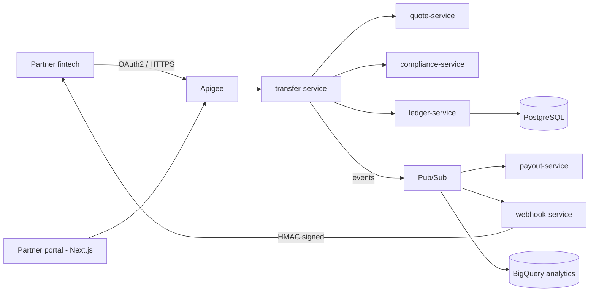

# Puente

**API-first cross-border remittances & payments platform on Google Cloud.**

Puente lets fintechs and remittance companies send money from the US to Central America (SV, GT, HN) through a single API: real-time FX quotes, sanctions screening, a double-entry ledger, payouts to banks and wallets, and signed webhooks — built to never lose or duplicate a cent.

> 🚧 **Status:** Phase 0 — foundations & walking skeleton. This README describes the target platform; the [roadmap](#roadmap) shows what is already built.

---

## Why this project

Remittances are a core part of Central American economies, yet integrating with payout networks is slow, fragile and hard to audit. Puente is a reference implementation of how a modern, cloud-native payments platform should be **designed, secured, operated and recovered** — not just coded.

## Key capabilities

| Capability | How |
|---|---|
| **Exactly-once money movement** | `Idempotency-Key` on every write; retries never duplicate a transfer |
| **Double-entry ledger** | Immutable, balanced debit/credit entries; RPO 0 target |
| **Compliance screening** | Sanctions lists (OFAC SDN), per-customer limits, velocity rules, manual review queue |
| **Resilient payouts** | Adapters to simulated banks/wallets that fail on purpose; circuit breakers, retries, DLQ |
| **Partner webhooks** | HMAC-signed, at-least-once delivery with exponential backoff |
| **API management** | Apigee: OAuth2 client credentials, API products, quotas, spike arrest, versioning |
| **Partner portal** | Next.js + TypeScript portal and compliance back-office with OIDC auth |

## Target architecture



## Services

| Service | Responsibility | Key pattern |
|---|---|---|
| `quote-service` | FX quotes with TTL | Caching, expiry |
| `transfer-service` | Transfer lifecycle | Orchestrated saga, state machine |
| `compliance-service` | Sanctions, limits, velocity | Rules engine, audit trail |
| `ledger-service` | Double-entry bookkeeping | Strong consistency, transactional outbox |
| `payout-service` | Bank / wallet adapters | Idempotency, circuit breaker |
| `webhook-service` | Partner notifications | At-least-once, DLQ, backoff |
| `partner-portal` | Portal & back-office | OIDC, CDN delivery |

## Roadmap

| Version | Scope | Platform | Status |
|---|---|---|---|
| **v0** | Walking skeleton: quote + transfer services, IaC, keyless CI/CD, cost guardrails | Cloud Run | 🟡 In progress |
| **v1** | All services, Apigee, Identity Platform, partner portal | Cloud Run | ⚪ Planned |
| **v2** | Private networking, managed PostgreSQL, Pub/Sub, Secret Manager, Cloud Armor | Cloud Run + VPC | ⚪ Planned |
| **v3** | Kubernetes, GitOps, progressive delivery | GKE + Argo CD | ⚪ Planned |
| **v4** | Multi-region, tested DR, SLOs & error budgets, FinOps, hardened security | GKE multi-region | ⚪ Planned |

## Non-functional targets (v4)

| Attribute | Target |
|---|---|
| Availability (`POST /transfers`) | 99.9% |
| Latency p95 (sync path) | < 300 ms |
| Ledger RPO / RTO | 0 / < 1 h |
| Duplicate transfers under retries | 0 (proven with load + chaos tests) |
| Idle cost | $0 (everything destroyable or in free tier) |

## Engineering principles

- **Everything as code** — Terraform for all infrastructure; no click-ops.
- **Zero long-lived keys** — GitHub Actions authenticates via Workload Identity Federation (OIDC).
- **Secure by default** — least privilege, secrets in Secret Manager, encryption in transit and at rest, signed images and SBOMs.
- **Cost guardrails first** — budgets and alerts exist before any resource; every lab ends with `destroy`.
- **Decisions are documented** — every significant choice is recorded as an [ADR](docs/adr).

## Tech stack

| Layer | Technology |
|---|---|
| Backend | Java 21, Spring Boot, Maven |
| Frontend | Next.js, TypeScript |
| API management | Apigee |
| Compute | Cloud Run → GKE |
| Data & messaging | PostgreSQL, Firestore, Pub/Sub, BigQuery |
| IaC | Terraform |
| CI/CD | GitHub Actions + Workload Identity Federation |
| Supply chain | Trivy, Syft (SBOM), cosign |
| Observability | OpenTelemetry, Cloud Monitoring, Cloud Trace |
| Testing | JUnit, k6 load tests |

## Repository layout

```
puente/
├── apigee/            # API proxies & shared flows
├── docs/
│   ├── adr/           # Architecture Decision Records
│   └── labs/          # Hands-on lab journal: what broke and how it was fixed
├── frontend/          # Partner portal (Next.js)
├── infra/terraform/
│   ├── bootstrap/     # Remote state, Workload Identity Federation
│   ├── modules/       # Reusable modules
│   └── envs/dev/      # Environment composition
├── scripts/           # Automation (lab teardown, helpers)
├── services/          # Spring Boot microservices
└── .github/workflows/ # CI/CD pipelines
```

## Architecture decisions

| ADR | Decision |
|---|---|
| [0001](docs/adr/0001-monorepo.md) | Monorepo |

## Disclaimer

Puente is a portfolio and learning project. It is not affiliated with any financial institution, moves no real money, and all payout partners are simulated.

## Author

**Manuel Cardoza** — Backend engineer moving into cloud & platform engineering.
[GitHub](https://github.com/JCardzZ)
